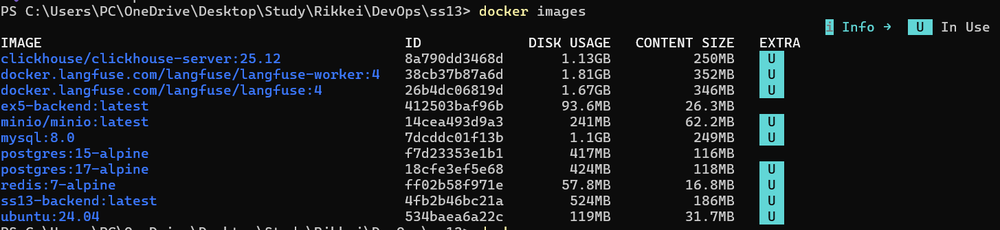
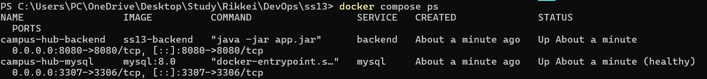
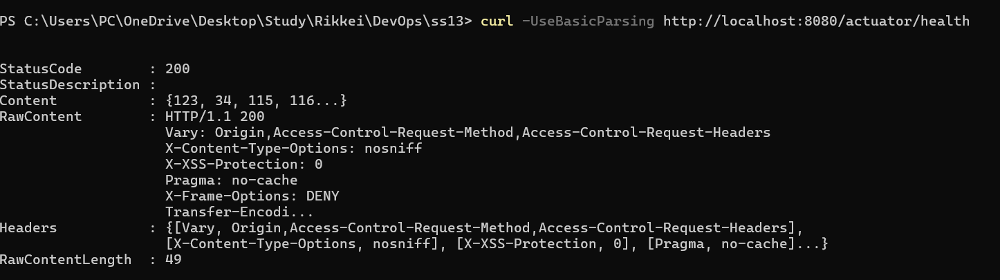

# Campus Hub — Bài Kiểm Tra Docker

## Thông Tin Sinh Viên

| Họ và tên | Mã sinh viên |
|---|---|
| Nguyễn Mạnh Thắng | B24DTCN449 |

---

## Mô tả

Campus Hub là ứng dụng backend Spring Boot được đóng gói thành Docker Image và chạy cùng MySQL bằng Docker Compose.

---

## Cấu trúc Project

```text
.
├── backend/
│   ├── Dockerfile          # Multi-stage build: JDK 21 Alpine → JRE 21 Alpine
│   ├── .dockerignore       # Loại bỏ build/, .gradle/, .idea/, logs/
│   └── src/...
├── compose.yml             # Docker Compose: backend + mysql
└── README.md
```

---

## Lệnh Chạy Hệ Thống

### 1. Chạy kiểm thử backend bằng Gradle

```bash
cd backend
./gradlew test
```

### 2. Build Docker Image

```bash
# Từ thư mục backend/
docker build -t campus-hub-backend .

# Kiểm tra image đã tạo
docker images | grep campus-hub-backend
```

### 3. Chạy hệ thống bằng Docker Compose

```bash
# Từ thư mục gốc (chứa compose.yml)
docker compose up -d

# Kiểm tra trạng thái các service
docker compose ps

# Xem logs
docker compose logs -f backend
```

### 4. Kiểm tra health endpoint

```bash
curl http://localhost:8080/actuator/health
```

### 5. Dừng hệ thống

```bash
docker compose down
```

---

## Cổng & URL

| Service | Cổng | URL |
|---|---|---|
| Backend | 8080 | http://localhost:8080 |
| Health Check | 8080 | http://localhost:8080/actuator/health |
| MySQL | 3307 (host) | localhost:3307 |

---

## Biến Môi Trường Backend

| Biến | Giá trị trong Compose | Mô tả |
|---|---|---|
| `DB_URL` | `jdbc:mysql://mysql:3306/campus_hub?...` | URL kết nối MySQL (dùng service name `mysql`) |
| `DB_USERNAME` | `campushub` | Tên đăng nhập MySQL |
| `DB_PASSWORD` | `campushub123` | Mật khẩu MySQL |
| `SERVER_PORT` | `8080` | Cổng backend |

---

## Tài Khoản Mẫu

| Vai trò | Tên đăng nhập | Mật khẩu |
|---|---|---|
| Sinh viên | `student` | `student123` |
| Quản trị viên | `admin` | `admin123` |

---

## Minh Chứng

### 1. Docker Image build thành công



### 2. Trạng thái các service sau khi chạy Compose



### 3. Kết quả gọi /actuator/health



---

## Kiến trúc Docker

```text
┌─────────────────────────────────┐
│        campus-hub-network       │
│                                 │
│  ┌──────────────┐               │
│  │   backend    │ :8080 ──────► host:8080
│  │ (Spring Boot)│               │
│  └──────┬───────┘               │
│         │ DB_URL=mysql:3306      │
│  ┌──────▼───────┐               │
│  │    mysql     │ :3306 ──────► host:3307
│  │  (MySQL 8.0) │               │
│  └──────────────┘               │
└─────────────────────────────────┘
```
